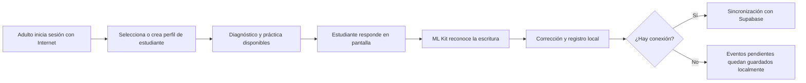

# K-Mat IA

**K-Mat IA** es una aplicación Android de apoyo al aprendizaje matemático para estudiantes de 1.º y 2.º básico. El MVP reúne práctica matemática, reconocimiento de escritura, seguimiento del progreso y herramientas para responsables, docentes y administradores.

La respuesta se escribe con el dedo o un lápiz digital en la pantalla. Google ML Kit Digital Ink Recognition interpreta los trazos; la aplicación no usa la cámara ni OCR de fotografías.

## Estado del MVP

El MVP está implementado y preparado para demostración y uso dentro del alcance descrito aquí. Incluye:

- **Cuentas y perfiles:** inicio de sesión con Supabase Auth, registro de cuentas de responsables y docentes, perfiles de estudiantes vinculados a un adulto y navegación según el rol.
- **Diagnóstico y práctica:** diagnóstico inicial, ejercicios disponibles, escritura en pantalla, reconocimiento de respuestas, corrección y registro de intentos.
- **Progreso:** registro local de sesiones y respuestas, consulta de resultados e historial disponible.
- **Herramientas docentes:** salas y códigos de vinculación, consulta de estudiantes y progreso, asignación de refuerzos disponibles y exportación de reportes individuales en PDF.
- **Herramientas de administración:** consulta y gestión de cuentas y roles, instrucciones de recuperación de contraseña y eliminación de cuentas.
- **Persistencia y sincronización:** Room conserva datos de práctica en el dispositivo. WorkManager intenta sincronizar los eventos pendientes con Supabase cuando vuelve la conexión.
- **Apoyos complementarios:** recursos de práctica, pausas activas y funciones de sugerencias o voz con Gemini cuando el backend correspondiente está configurado.

El alcance pedagógico corresponde a un MVP: los contenidos y ejercicios disponibles son acotados y algunas funciones complementarias pueden depender de la configuración de Supabase. La práctica sin conexión está disponible después de iniciar sesión y de contar localmente con los datos necesarios y el modelo de escritura descargado. El inicio de sesión y la sincronización remota requieren Internet.

## Flujo principal



## Tecnologías

- Kotlin, Jetpack Compose y Material 3.
- Android SDK 35; Android 8.0 (API 26) como versión mínima.
- Room para persistencia local y WorkManager para sincronización diferida.
- Google ML Kit Digital Ink Recognition para reconocimiento de escritura manuscrita.
- Supabase Auth, PostgreSQL con Row Level Security (RLS) y Edge Functions.
- Gemini para algunas funciones opcionales del backend.

## Ejecutar en desarrollo

1. Abre la carpeta [android-app](android-app) en Android Studio.
2. Usa el JDK integrado (Java 17) e instala Android SDK Platform 35 si Android Studio lo solicita.
3. Configura las propiedades de Supabase indicadas abajo para habilitar inicio de sesión y servicios remotos.
4. Ejecuta la configuración `app` en un dispositivo o emulador Android 8.0 o superior.

La primera vez que se use el reconocimiento manuscrito, el dispositivo necesita Internet para descargar el modelo de ML Kit. Luego el reconocimiento funciona localmente.

## Configurar Supabase

La aplicación incluida en este repositorio tiene configurada la URL y la clave pública (publishable) del proyecto Supabase del MVP en `android-app/gradle.properties`. La clave pública está diseñada para uso en aplicaciones cliente; los permisos se controlan con autenticación y políticas RLS. **Nunca agregues una clave `service_role` al APK ni al repositorio.**

Para conectar la aplicación a otro proyecto de Supabase, configura estas propiedades en `%USERPROFILE%\.gradle\gradle.properties` o como variables de entorno:

```properties
SUPABASE_URL=https://TU_PROYECTO.supabase.co
SUPABASE_PUBLISHABLE_KEY=tu_clave_publica
SUPABASE_EXERCISE_VERSION_ID=uuid_de_la_version_publicada
```

El proyecto alternativo también debe tener las migraciones y Edge Functions de este repositorio desplegadas y los datos requeridos preparados. Cambiar las claves no conecta la aplicación a Firebase: la integración actual es con Supabase.

Para preparar un proyecto nuevo:

1. Aplica en orden cronológico las migraciones de [supabase/migrations](supabase/migrations).
2. Despliega las funciones de [supabase/functions](supabase/functions) que usa la aplicación, en particular `sync-learning-data`.
3. Si habilitarás voz o sugerencias con Gemini, configura `GEMINI_API_KEY` como secreto del backend y despliega las funciones correspondientes.
4. Para datos de demostración, crea en Supabase Auth las cuentas indicadas en [poblacion_inicial_mvp.sql](supabase/poblacion_inicial_mvp.sql) y luego ejecuta ese script.

Consulta la [documentación de base de datos](supabase/DOCUMENTACION_BASE_DE_DATOS.md) para los detalles de configuración.

## Compilar

Desde la carpeta `android-app`:

```powershell
.\gradlew.bat assembleDebug
```

El APK de depuración se genera en `android-app/app/build/outputs/apk/debug/`. Para instalar la app directamente en una tablet o teléfono, Android puede solicitar permiso para instalar aplicaciones desde la fuente usada para abrir el archivo.

## Documentación

- [Guía de Android](android-app/README.md)
- [Arquitectura](android-app/docs/ARQUITECTURA.md)
- [Autenticación](android-app/docs/AUTENTICACION.md)
- [Uso sin conexión y sincronización](android-app/docs/OFFLINE_FIRST.md)
- [Navegación](android-app/docs/NAVEGACION.md)
- [Base de datos](supabase/DOCUMENTACION_BASE_DE_DATOS.md)
